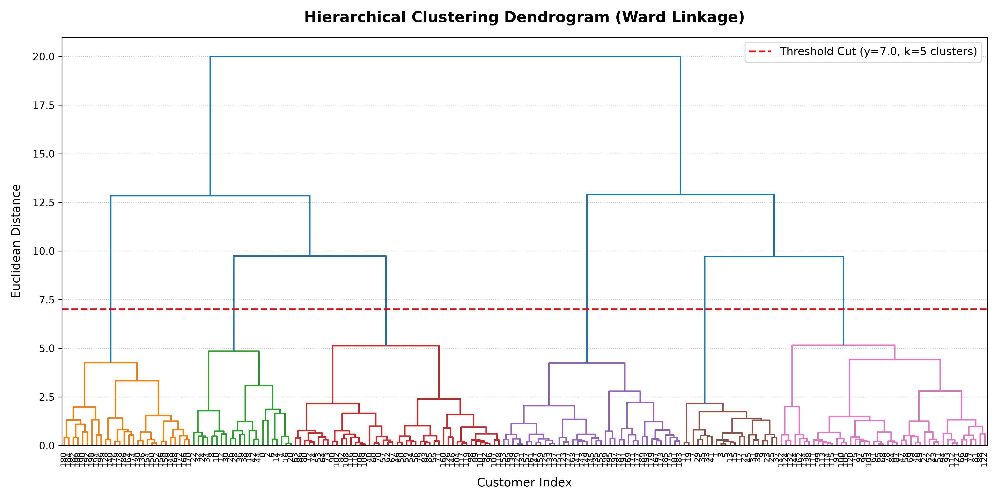
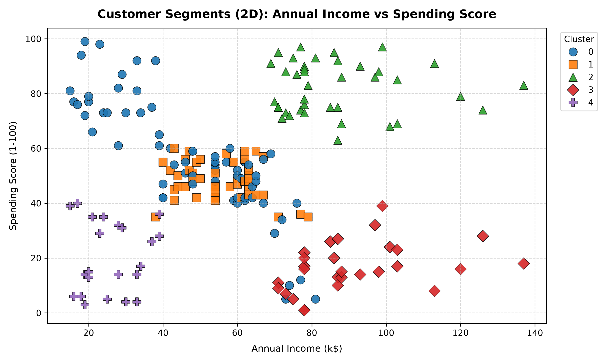
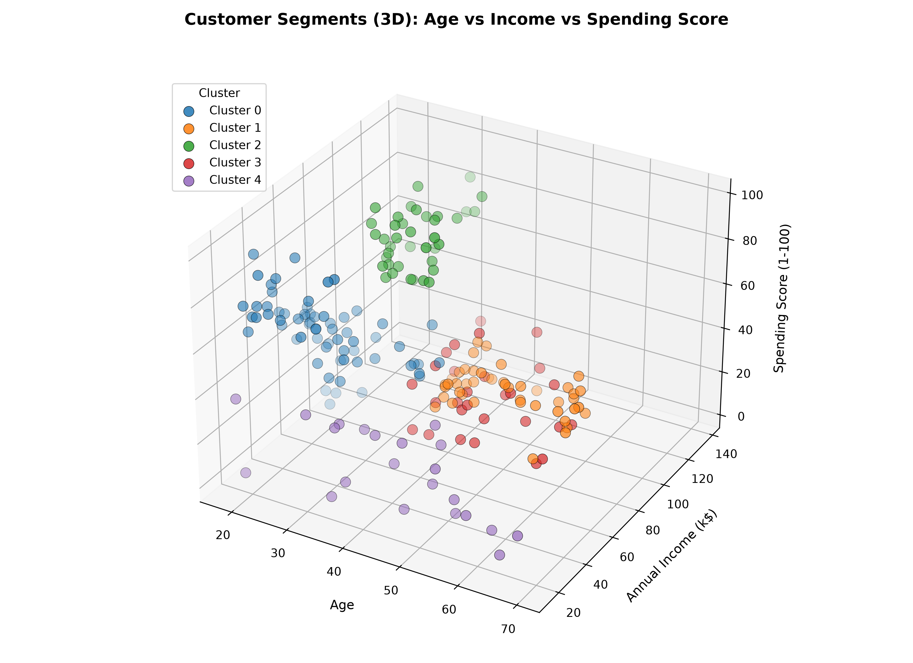

# Customer Segmentation Using Hierarchical Clustering (Agglomerative)

## 1. Project Overview & Objective
This project implements **Task 6: Customer Segmentation Using Hierarchical Clustering** on the Mall Customers dataset. The primary objective is to discover meaningful customer segments based on demographic and financial behavior (`Age`, `Annual Income (k$)`, and `Spending Score (1-100)`) to guide personalized marketing and customer relationship management.

---

## 2. Dataset Exploration Findings
- **Source**: Mall Customers Dataset (`Mall_Customers.csv`)
- **Dimensions**: 200 customer records, 5 original attributes (6 after clustering assignment).
- **Attributes**:
  - `CustomerID`: Unique identifier for each customer (excluded from modeling).
  - `Gender`: Customer gender (`Female`, `Male`).
  - `Age`: Age in years (ranging from 18 to 70).
  - `Annual Income (k$)`: Customer annual income in thousands of dollars (ranging from $15k to $137k).
  - `Spending Score (1-100)`: Behavioral score assigned based on spending habits and purchase history.
- **Data Quality**: 0 missing or null values detected across all columns.

---

## 3. Preprocessing & Standardization Pipeline
1. **Identifier Removal**: `CustomerID` was dropped to avoid index-based bias.
2. **Categorical Encoding**: `Gender` was mapped numerically (`Female: 0`, `Male: 1`).
3. **Feature Selection**: Extracted the core numerical features for segmentation:
   - `Age`
   - `Annual Income (k$)`
   - `Spending Score (1-100)`
4. **Standardization**: Applied `StandardScaler` to ensure zero mean ($\mu = 0$) and unit variance ($\sigma = 1$), preventing features with larger scales (such as income) from dominating Euclidean distance calculations.

---

## 4. Hierarchical Clustering & Dendrogram Interpretation
- **Linkage Criterion**: **Ward's minimum variance method** (`method='ward'`) using Euclidean distance metric (`metric='euclidean'`).
- **Dendrogram Cutting**: Analyzing the linkage tree, the largest vertical leap without horizontal intersections occurs around distance $7.0$.
- **Cluster Selection**: A horizontal threshold cut at $y = 7.0$ cleanly partitions the customer base into **5 optimal clusters**.

---

## 5. Model Evaluation
- **Algorithm**: `AgglomerativeClustering(n_clusters=5, metric='euclidean', linkage='ward')`
- **Silhouette Score**: **`0.3900`**
  - Indicates well-defined cluster separation and internal cohesion across the standardized 3D feature space.

---

## 6. Cluster Persona Profiles & Breakdown

| Cluster ID | Segment Persona | Size (% of Total) | Mean Age | Mean Income (k$) | Mean Spending Score | Recommended Strategy |
|:---:|:---|:---:|:---:|:---:|:---:|:---|
| **0** | **Young Active Spenders** | 66 (33.0%) | 26.6 | $47.4k | 56.8 / 100 | Digital marketing, trendy apparel, rewards loyalty programs. |
| **1** | **Senior Moderate Spenders** | 45 (22.5%) | 56.4 | $55.3k | 48.4 / 100 | Value-driven promotions, reliable customer service, household essentials. |
| **2** | **Affluent High Spenders (VIPs)** | 39 (19.5%) | 32.7 | $86.5k | 82.1 / 100 | Luxury product previews, concierge services, VIP events. |
| **3** | **High Earners / Cautious Savers** | 28 (14.0%) | 43.9 | $91.3k | 16.7 / 100 | High-quality investments, premium memberships, targeted incentive discounts. |
| **4** | **Budget-Conscious / Low Spend** | 22 (11.0%) | 44.3 | $25.8k | 20.3 / 100 | Clearance sales, discount vouchers, economy bundle offerings. |

---

## 7. Cluster Visualizations

### 2D Segmentation: Annual Income vs. Spending Score

### 3D Segmentation: Age vs. Annual Income vs. Spending Score

---

## 8. File Structure
- `task6_clustering.py`: End-to-end Python pipeline executing Phases 1 through 5.
- `Mall_Customers.csv`: Raw dataset.
- `Mall_Customers_Segmented.csv`: Output dataset labeled with cluster assignments.
- `dendrogram.png`: High-resolution hierarchical clustering dendrogram with threshold cut.
- `clusters_2d.png`: 2D scatter plot visualization of customer segments.
- `clusters_3d.png`: 3D scatter plot visualization in feature space.
- `README.md`: Comprehensive project documentation.
